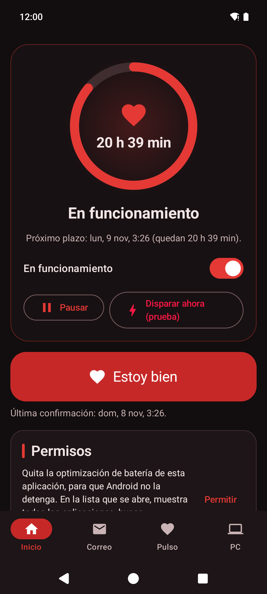
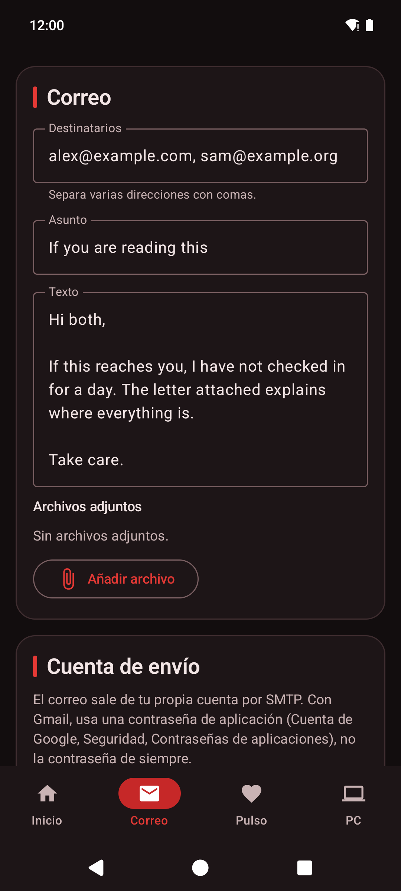
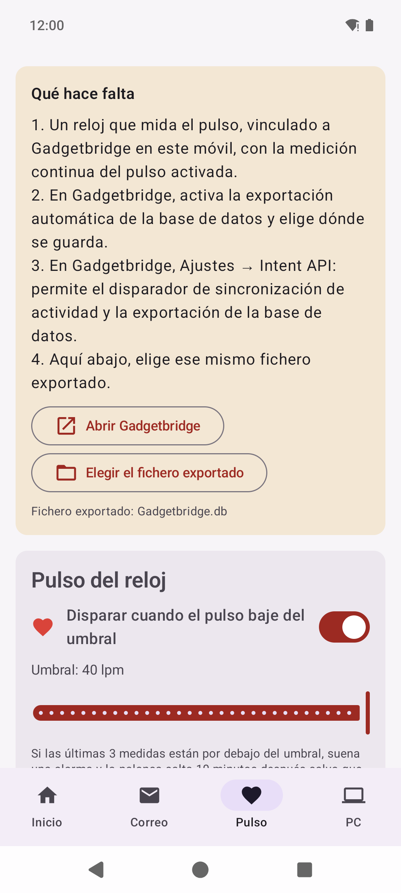
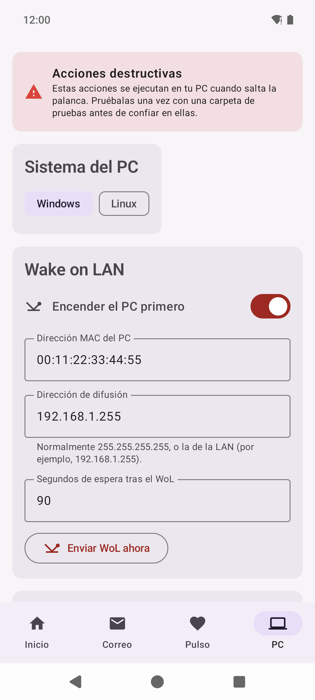

# DeadManShot

<p align="center"><a href="README.md">English</a> · Español</p>

<p align="center">
  
  
  
  
</p>

Aplicación Android que funciona como **palanca del hombre muerto**. Pulsas **Estoy bien** una vez
al día, o cada cuanto elijas. Si dejas de hacerlo, o si el reloj indica que te ha bajado el pulso,
la aplicación **envía el correo que hayas preparado** y puede **actuar sobre tu ordenador**,
Windows o Linux, por SSH: encenderlo, ejecutar un comando tuyo, destruir una clave de cifrado,
borrar una carpeta a fondo y apagarlo.

No recoge nada: la aplicación solo habla con el servidor de correo y el ordenador que configures.
Consulta la [política de privacidad](PRIVACY.md).

En inglés, español, portugués, francés, alemán, italiano, neerlandés, polaco, ruso, ucraniano,
chino, japonés, coreano, tailandés e hindi.

> **Beta.** Las acciones sobre el ordenador son destructivas a propósito. Prueba antes toda la
> cadena con una carpeta de prueba y el botón **Disparar ahora (prueba)**, y solo después apúntala
> a algo de verdad.

## Instalación

- **APK** de la [última versión](https://github.com/javimentallab/DeadManShot/releases/latest).
- Google Play: en camino.

Android 12 o posterior.

---

## Pestañas

**Inicio** → la tarjeta de estado (un círculo rojo cuando está parada, un corazón que late cuando
funciona), el botón grande **Estoy bien** y el interruptor que la pone en marcha. Elige cada cuánto
tienes que confirmar (de 10 minutos a 3 días) y los recordatorios que quieras antes del plazo (de
5 minutos a 4 horas); cada recordatorio es una notificación con su propio botón *Estoy bien*.
**Pausar** detiene la cuenta atrás desde una hora hasta un mes; al acabar la pausa, la cuenta
atrás vuelve a empezar de cero. **Disparar ahora (prueba)** hace exactamente lo mismo que un plazo
vencido, después de decirte a quién va el correo y qué se ejecutará en el ordenador.

**Correo** → destinatarios, asunto, texto y adjuntos, y la cuenta desde la que sale (la tuya, por
SMTP, siempre con TLS y comprobando el certificado). *Rellenar por defecto* pone el servidor de
Gmail, Yahoo, iCloud o Proton Mail. *Enviar una prueba a mi dirección* te
manda el mismo correo con «[Prueba]» en el asunto. El interruptor no se puede encender hasta que
haya un destinatario, un texto y una cuenta.

Lo que pide cada proveedor, que la pestaña también explica:

- **Gmail, Yahoo, iCloud**: una *contraseña de aplicación* (16 letras que creas para esta
  aplicación), no la de siempre. La pestaña tiene un botón a la página donde se crea.
- **Proton Mail**: un *token SMTP*, que Proton solo ofrece para direcciones con dominio propio en un
  plan de pago (`smtp.protonmail.ch`, 587, STARTTLS).
- **Outlook, Hotmail, Microsoft 365**: ya no aceptan una contraseña para enviar, solo un inicio de
  sesión de Microsoft (OAuth) que la aplicación todavía no hace, así que por ahora no funcionan.
- **Los demás** (GMX, Zoho, Fastmail, el de tu operador o un dominio propio): usuario y contraseña,
  o una contraseña de aplicación si ese proveedor la pide.

**Pulso** → opcional. Con un reloj vinculado a [Gadgetbridge](https://gadgetbridge.org/), la
aplicación pide a Gadgetbridge cada 15, 30 o 60 minutos que sincronice el reloj y exporte su base
de datos, y lee de esa copia las últimas medidas del pulso. Si las tres últimas están por debajo
del umbral (de 10 a 40 lpm), suena una alarma y la palanca salta diez minutos después salvo que
pulses *Estoy bien*; una medida normal después de la alarma la anula. También puede saltar si el
reloj no manda nada durante 30 minutos a 12 horas, pero nunca porque Gadgetbridge haya dejado de exportar.

**PC** → elige *Windows* o *Linux* y, después, cualquiera de estas acciones, en este orden:

1. **Wake on LAN**, y esperar el tiempo que pongas a que arranque el ordenador.
2. **Ejecutar un comando**: lo que escribas, con las líneas que quieras, en PowerShell (Windows) o
   bash (Linux), con el usuario SSH. No se abre ninguna ventana; la salida llega en la notificación
   del resultado.
3. **Destruir la clave**: sobrescribir cinco veces y borrar un fichero o carpeta de clave. Guarda los
   datos sensibles en un contenedor cifrado (VeraCrypt, LUKS, EFS, 7-Zip…) cuya clave viva ahí, y
   los datos quedan inaccesibles para siempre.
4. **Destruir una carpeta**: cada fichero se sobrescribe en el sitio cinco veces (primero ceros y luego datos
   aleatorios), se vuelca al disco y solo entonces se borra.
5. **Apagarlo**: `shutdown /s /f /t 0` en Windows; `sudo -n systemctl poweroff` en Linux, que
   necesita sudo sin contraseña para ese comando o permiso de polkit para apagar.

*Probar SSH* ejecuta `echo ok`. La primera vez se guarda la clave del servidor; si cambia alguna
vez, se rechaza la conexión.

## Cómo se protegen las acciones

- Se rechazan las rutas que sean la raíz de un disco, un nivel por debajo, una carpeta de usuario
  entera (`C:\Users\nombre`, `/home/nombre`), una carpeta del sistema, una ruta relativa, o que
  lleven `..` o comodines.
- Los enlaces no se siguen. Un fichero que no se pueda sobrescribir (bloqueado, sin permiso) se
  deja donde está y se avisa; nunca se borra sin sobrescribir. Sin *Incluir subdirectorios*, las
  subcarpetas no se tocan. Las carpetas solo se borran cuando quedan vacías.
- Las rutas y los comandos viajan en base64, así que ningún carácter puede romper el guion.
- Cada acción informa: cuántos ficheros se destruyeron, qué falló y por qué, y el código de salida
  y la salida de tu comando. «Correcto» solo si salió todo.
- Todo tiene que caber en los diez minutos que Android da a una tarea en segundo plano, contando la
  espera tras el Wake on LAN. Pulsar *Estoy bien* mientras tanto lo detiene.
- En un SSD el firmware puede conservar copias antiguas de los bloques sobrescritos; por eso es más
  seguro destruir la clave de un contenedor cifrado.

Las acciones solo llegan al ordenador si el móvil puede llegar a él: en la misma red, o por una VPN
o un puerto redirigido.

## Cómo funciona

- Una alarma exacta para lo siguiente que tenga que pasar (un recordatorio, el plazo, el fin de una
  pausa) y un vigilante de WorkManager cada 15 minutos por si se pierde la alarma. Las alarmas se
  vuelven a poner tras reiniciar o actualizar. Si el móvil estuvo apagado al vencer el plazo, salta
  al volver.
- El correo sale por un cliente SMTP propio, sin biblioteca de correo.
- El SSH usa [JSch](https://github.com/mwiede/jsch) con autenticación por contraseña.
- Las contraseñas del correo y del SSH se guardan cifradas (AES-GCM) con una clave que nunca sale
  del almacén de claves de Android. La copia de seguridad de la aplicación está desactivada.

Para que el plazo se cumpla a su hora, permite las alarmas exactas y quita la optimización de
batería de la aplicación; la pestaña Inicio indica lo que falta.

## Compilar

JDK 21, Android SDK 36:

```
./gradlew testDebugUnitTest assembleDebug
```

Las versiones de publicación se firman cuando un fichero `keystore.properties` (fuera del
repositorio) apunta a la clave.

## Contribuir

Consulta [CONTRIBUTING](CONTRIBUTING.md), en inglés. Para avisar en privado de un problema de seguridad, consulta [SECURITY](SECURITY.md).

## Licencia

[PolyForm Noncommercial 1.0.0](LICENSE): se permite cualquier uso no comercial; el uso comercial necesita permiso del autor. Las versiones hasta la 0.9.3 se publicaron con licencia MIT. Las licencias de terceros están en [NOTICE](NOTICE).
