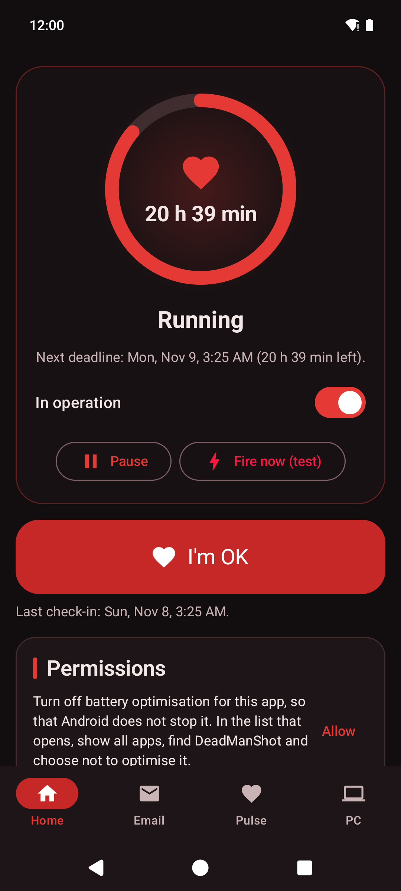
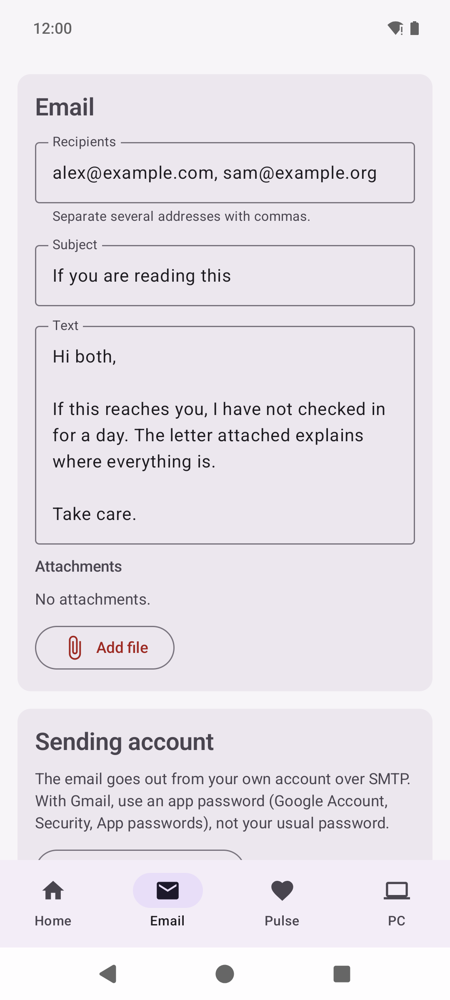
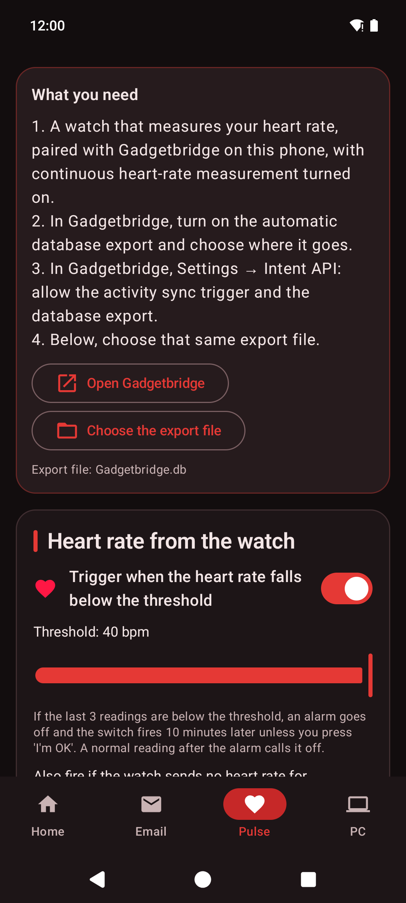
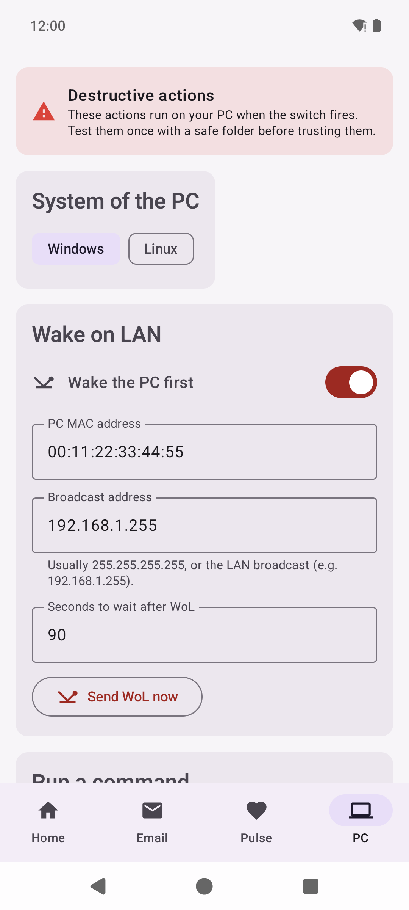

# DeadManShot

<p align="center">English · <a href="README.es.md">Español</a></p>

<p align="center">
  
  
  
  
</p>

Android app that works as a **dead man's switch**. You press **I'm OK** once a day, or as often
as you choose. If you stop, or if your watch says your heart rate has dropped, the app **sends the
email you prepared** and can **act on your computer**, Windows or Linux, over SSH: wake it up, run
a command of your own, destroy an encryption key, shred a folder and shut it down.

Nothing is collected: the app only talks to the mail server and the computer you set up. See the
[privacy policy](PRIVACY.md).

In English, Spanish, Portuguese, French, German, Italian, Dutch, Polish, Russian, Ukrainian,
Chinese, Japanese, Korean, Thai and Hindi.

> **Beta.** The actions on the computer are destructive by design. Try the whole chain first with
> a test folder and the **Fire now (test)** button, and only then point it at anything real.

## Install

- **APK** from the [latest release](https://github.com/javimentallab/DeadManShot/releases/latest).
- Google Play: on its way.

Android 12 or later.

---

## Tabs

**Home** → the status card (a red circle while stopped, a beating heart while running), the big
**I'm OK** button and the switch that starts it. Choose how often you have to check in (from 10
minutes to 3 days) and any number of reminders before the deadline (5 minutes to 4 hours); each
reminder is a notification with its own *I'm OK* button. **Pause** stops the countdown for an hour
up to a month; when the pause ends, the countdown starts again from zero. **Fire now (test)** does
exactly what a missed deadline does, after telling you who gets the email and what will run on
the computer.

**Email** → recipients, subject, text and attachments, and the account it goes out from (your own,
over SMTP, always with TLS and the certificate checked). *Fill with defaults* sets the server for
Gmail, Yahoo, iCloud or Proton Mail. *Send a test to my own address* sends
the same email to you with "[Test]" in the subject. The switch cannot be turned on until there is a
recipient, a text and an account.

What each provider asks for, which the tab also explains:

- **Gmail, Yahoo, iCloud**: an *app password* (16 letters you create for this app), not your
  usual password. The tab has a button to the page where it is created.
- **Proton Mail**: an *SMTP token*, which Proton only offers for addresses on your own domain with a
  paid plan (`smtp.protonmail.ch`, 587, STARTTLS).
- **Outlook, Hotmail, Microsoft 365**: they no longer accept a password for sending, only a
  Microsoft sign-in (OAuth) that the app does not do yet, so they do not work for now.
- **Others** (GMX, Zoho, Fastmail, your ISP or your own domain): user and password, or an app
  password if that provider asks for one.

**Pulse** → optional. With a watch paired with [Gadgetbridge](https://gadgetbridge.org/), the app
asks Gadgetbridge every 15, 30 or 60 minutes to sync the watch and export its database, and reads
the latest heart-rate readings from that export. If the last three are under the threshold (10 to
40 bpm), an alarm goes off and the switch fires ten minutes later unless you press *I'm OK*; a
normal reading after the alarm calls it off. It can also fire when the watch sends nothing for 30
minutes to 12 hours, but never because Gadgetbridge itself stopped exporting.

**PC** → choose *Windows* or *Linux*, then any of these, in this order:

1. **Wake on LAN**, and wait a set time for the computer to boot.
2. **Run a command**: what you type, any number of lines, in PowerShell (Windows) or bash
   (Linux), as the SSH user. No window opens; the output comes back in the result notification.
3. **Destroy the key**: overwrite five times and delete a key file or folder. Keep the sensitive data in
   an encrypted container (VeraCrypt, LUKS, EFS, 7-Zip…) whose key lives there, and the data stays
   locked for good.
4. **Shred a folder**: every file is overwritten in place five times (zeros first, then random data), flushed
   to disk and only then deleted.
5. **Shut it down**: `shutdown /s /f /t 0` on Windows; `sudo -n systemctl poweroff` on Linux, which
   needs passwordless sudo for that command or polkit permission to power off.

*Test SSH* runs `echo ok`. The first time, the server's key is remembered; if it ever changes, the
connection is refused.

## How the actions stay safe

- Paths are refused if they are a drive root, one level below it, a whole user folder
  (`C:\Users\name`, `/home/name`), a system folder, relative, or contain `..` or wildcards.
- Links are not followed. A file that cannot be overwritten (locked, no permission) is left where
  it is and reported; it is never deleted unwiped. Without *Include subdirectories*, subfolders
  are not touched. Folders are removed only once empty.
- Paths and commands travel base64-encoded, so no character in them can break the script.
- Every action reports back: how many files were destroyed, what failed and why, the exit code
  and output of your command. "OK" only when everything went.
- All of it has to fit in the ten minutes Android gives a background task, counting the wait after
  Wake on LAN. Pressing *I'm OK* meanwhile stops it.
- On an SSD the firmware may keep old copies of overwritten blocks, which is why destroying the key
  of an encrypted container is the safer option.

The actions only reach the computer if the phone can reach it: on the same network, or through a
VPN or a forwarded port.

## How it works

- One exact alarm for the next thing that has to happen (a reminder, the deadline, the end of a
  pause), plus a WorkManager watchdog every 15 minutes in case the alarm is lost. Alarms are set
  again after a reboot or an update. If the phone was off past the deadline, it fires when it
  comes back.
- The email goes through a small SMTP client of its own, with no mail library.
- SSH uses [JSch](https://github.com/mwiede/jsch) with password authentication.
- The mail and SSH passwords are encrypted (AES-GCM) with a key that never leaves the Android
  keystore. App backup is off.

For the best timing, allow exact alarms and turn off battery optimisation for the app; the Home
tab shows what is missing.

## Building

JDK 21, Android SDK 36:

```
./gradlew testDebugUnitTest assembleDebug
```

Release builds are signed when a `keystore.properties` file (not in the repository) points at
the key.

## Contributing

See [CONTRIBUTING](CONTRIBUTING.md). To report a security problem privately, see [SECURITY](SECURITY.md).

## License

[PolyForm Noncommercial 1.0.0](LICENSE): any noncommercial use is allowed; commercial use needs the author's permission. Versions up to 0.9.3 were released under the MIT licence. Third-party licences are in [NOTICE](NOTICE).
